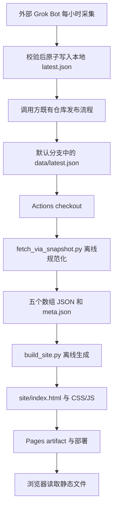

# X AI 新闻站架构方案（方案 B）

角色：DN-B Navigator。目标仓库：`axureboutique/x-ai-news`。工作目录：`/workspace/x-ai-news/`。

本文是交给 Driver 的实施规格；本次仅交付本文件，不实现脚本、页面、工作流，不重新请求 X，也不执行提交或部署。

## 1 目标与非目标

### 1.1 目标

- 直接消费已经落盘的 `data/latest.json`，先规范化数据，再生成可独立部署的 HTML/CSS/JS 静态站。
- 首页突出 Grok Bot，提供中文 / English Tab、中文与英文帖子、AI 新闻、AI 趋势和数据更新时间；手机可完整阅读。
- 使用方案 B：Grok Bot 在自身运行环境负责采集；GitHub Actions 只做构建所需的校验、规范化、生成和 Pages 部署。
- `.github/workflows/pages.yml` 每小时触发一次构建，并提供手动触发和默认分支内容更新后的构建入口。
- 使用 GitHub 默认域名，预期项目地址为 `https://axureboutique.github.io/x-ai-news/`，不配置自定义域名。项目站点默认包含仓库子路径，部署后以 Pages 返回的实际地址为准。[GitHub Pages 地址规则](https://docs.github.com/en/pages/getting-started-with-github-pages/what-is-github-pages)
- 使用 Python 3.12 标准库及原生 CSS/JavaScript；数据转换和页面生成不需要网络、第三方 Python 包、Node 构建工具或 X 凭证。

### 1.2 非目标与边界

- Actions、两个 Python 脚本和浏览器均不调用 MCP `x`、X API、抓取代理或远程数据接口；不得添加假 Bearer、占位 token 或回退爬虫。
- 不新增后端、数据库、用户登录、评论、全文搜索、自动翻译或客户端 X 嵌入组件。
- 不把每小时重新构建描述为每小时获得新数据；数据新鲜度始终由快照的 `generated_at` 决定。
- 不改动 `auto-image-pipeline` 等其它项目，不新增独立采集工作流，不替调用方提交、开 PR、推送或合并主分支。

## 2 目录结构（精确文件）

以下为 Driver 实现完成后的文件边界。标记“已有”的文件已在当前工作区核对；本次只新增标记“本文”的文件。

```text
/workspace/x-ai-news/
├── SEED-NOTE.md                       # 已有，保留原样
├── .gitignore                        # Driver 新增：忽略 site/、Python 缓存
├── .github/
│   └── workflows/
│       └── pages.yml                 # Driver 新增：每小时构建与 Pages 部署
├── docs/
│   └── NAVIGATOR_PLAN.md              # 本文
├── scripts/
│   ├── fetch_via_snapshot.py          # Driver 新增：只读本地快照并规范化
│   ├── build_site.py                  # Driver 新增：生成完整静态站
│   └── grokbot_fetch_prompt.md        # Driver 新增：外部 Grok Bot 每小时采集说明
├── assets/
│   ├── site.css                      # Driver 新增：布局、主题、响应式、焦点样式
│   └── site.js                       # Driver 新增：语言 Tab、时间与过期提示
├── data/
│   ├── latest.json                   # 已有，唯一原始快照，规范化器不修改
│   ├── posts_zh.json                 # 已有，由规范化器重建
│   ├── posts_en.json                 # 已有，由规范化器重建
│   ├── news.json                     # 已有，由规范化器重建
│   ├── trends_ai.json                # 已有，由规范化器重建
│   ├── grokbot_posts.json             # 已有，由规范化器重建
│   └── meta.json                     # 已有，由规范化器重建并补充版本和校验信息
├── tests/
│   ├── test_fetch_via_snapshot.py     # Driver 新增：数据契约与异常处理测试
│   └── test_build_site.py             # Driver 新增：页面内容、安全转义、子路径测试
└── site/                             # 生成物，不提交；仅此目录上传 Pages
    ├── index.html                    # 所有内容在构建时生成
    └── assets/
        ├── site.css                  # 从 assets/site.css 复制
        └── site.js                   # 从 assets/site.js 复制
```

`build_site.py` 内放置小型 HTML 渲染函数和页面骨架，不引入模板框架。现有分拆 JSON 不删除，但它们是可重建的派生数据；每次正式构建都必须先执行规范化，不能假定仓库中的分拆文件已经同步。`site/` 不包含原始快照、脚本、测试、认证文件或整个仓库的副本。

## 3 数据流

### 3.1 已核对的输入

本次读取 `data/latest.json` 和 `SEED-NOTE.md`，没有重新拉 X。当前快照 `generated_at` 为 `2026-10-26T02:05:34+08:00`，`timezone` 为 `Asia/Shanghai`，`source` 为 `Grok Bot built-in X public reads (namespace x)`。

| 原始字段 | 当前形态与数量 | 规范化去向 |
| --- | --- | --- |
| `posts_zh` | 对象数组，7 条 | `data/posts_zh.json` |
| `posts_en` | 对象数组，6 条 | `data/posts_en.json` |
| `news` | 对象数组，7 条 | `data/news.json` |
| `trends_ai` | 空数组，0 条 | `data/trends_ai.json`，保留空数组 |
| `grokbot_posts` | 对象数组，6 条 | `data/grokbot_posts.json` |
| `trends_note` | 字符串，说明全球趋势中暂无明确 AI 词条 | `data/meta.json.trends_note` |
| `grokbot_intro` | `zh`、`en` 对象，各含 `title` 和 `bullets` | `data/meta.json.grokbot_intro` |
| `generated_at` | 带时区的 ISO 8601 字符串 | `data/meta.json.generated_at`，保留真实采集时间 |
| `timezone`、`source` | 已有附加元信息 | `data/meta.json` 同名字段 |

当前五个分拆数组与快照对应字段一致；现有 `meta.json` 包含表中五项元信息，但尚无下述规范化版本和校验字段。



当前 Driver 开发从已有 `data/latest.json` 开始，图中采集、仓库同步和线上部署均是后续运行职责，不在本次 Navigator 操作范围内。

### 3.2 快照进入仓库的交接点

Grok Bot 的本地写盘不会自动进入 GitHub runner。生产者完成后，必须由调用方既有提交与审核流程将新的 `data/latest.json` 纳入目标仓库默认分支，Actions 才能使用它。

本方案不授权代理直接推送或合并主分支。有明确提交授权且 `.git` 可写时，也只能准备独立更新分支，后续发布由调用方完成；当前 `.git` 不可写的工作区只交付文件和摘要。定时 Actions 本身没有仓库写权限，不承担这条同步链路。若同步尚未建立，站点仍可正常上线，但会按小时重建同一份快照，并按真实时间提示过期。

### 3.3 规范化契约

`fetch_via_snapshot.py` 的名称沿用任务要求，但功能是本地文件适配器。输入只接受本地路径，拒绝 URL，不读取 X 环境变量或认证文件，不发出网络请求。

**根结构：** JSON 顶层必须是对象；五个列表字段必须存在且为数组，`generated_at` 必须可解析并带时区，`trends_note` 必须为字符串，`grokbot_intro` 必须为对象。显式 `[]` 表示成功取得空结果；缺字段、`null` 或类型错误不能当成空结果。缺失 `timezone` 时默认 `Asia/Shanghai`，缺失 `source` 时使用说明性文本“本地快照”，并记录警告；不以默认值补造采集时间。

| 类型 | 输出字段与处理规则 |
| --- | --- |
| 帖子，适用于三个帖子数组 | 保留 `author_name`、`author_username`、`text`、`created_at`、`like_count`、`retweet_count`、`url`、`lang`；新增字符串 `id`。当前帖子没有独立 ID，从可信 X 状态 URL 的 `/status/<数字>` 提取；不能提取时，以作者、正文和时间的规范化值计算稳定 SHA-256 ID，不生成假原帖地址。 |
| 帖子内容 | `text` 必须是非空字符串；作者名缺失可回退到用户名，再回退“未知作者”。正文保留原文、换行、emoji 和语言，不机器翻译、不重写新闻事实。 |
| 互动数 | 非负整数保留，纯数字字符串可转整数；缺失或非法值归为 `null`，页面显示“—”，不能伪装成真实的 0。 |
| 新闻 | 保留字符串 `id`、`name`、`summary`、`url`、`updated_at`、`topics`；标题直接使用实际字段 `name`，不误读为 `title`。`name` 必须非空；缺少摘要或主题时分别用空字符串、空数组，ID 缺失时按 URL 或正文计算稳定字符串 ID。 |
| 趋势 | 当前没有非空样本，不能宣称已验证真实趋势条目的字段。约定下一版采集输出 `{name, url, rank, post_count}`：`name` 必须非空，其余可缺失并归为 `null`，`rank` 为正整数，`post_count` 为非负整数；首次有非空结果时由 Driver 核对适配，不凭空补榜单、热度或趋势链接。 |
| Grok Bot 简介 | 保留 `zh`、`en` 的 `title` 和字符串数组 `bullets`。缺某语言时允许回退到另一语言并标记原文；两种均无可展示内容时显示“简介暂无”，不生成替代宣传文案。 |
| 元信息 | 保留上述五项元信息，新增 `schema_version: 1`、`snapshot_sha256`（原始文件字节摘要）、`files_sha256`（五个输出数组文件的字节摘要映射）。不写入新的假 `generated_at`。 |

共同行为：

1. 只输出约定字段，未知原始字段忽略并计数，不把整段上游响应透传到页面或日志。
2. 所有 ID 保持字符串，避免 X 长整数经过 JavaScript 后丢失精度。帖子和新闻在各自数组内按稳定 ID 或规范化 URL 去重，冲突保留输入中第一条；Grok Bot 专区与普通帖子允许交叉出现。
3. 帖子按 `created_at`、新闻按 `updated_at` 从新到旧排序，同时间以 ID 升序打破平局；无效或缺失的条目时间归为 `null` 并排末尾，页面显示“时间未知”。有效条目时间统一输出 UTC ISO 8601；快照 `generated_at` 保留原值并按其真实时刻解析。
4. 趋势有有效排名时按排名升序，同排名保持输入次序；无排名条目置后并保持输入次序。不用帖子热度填补趋势。
5. URL 解析后仅保留带有效主机的 `https` / `http` 地址；拒绝脚本协议、凭证信息和控制字符。无效 URL 归为 `null`，保留可用文字但不生成可点击链接。只检查语法，不联网验证链接存活。
6. 单条记录不是对象或缺少必需正文/标题时跳过并警告；某个非空输入数组最终没有任何有效条目时整体失败，避免把格式变化伪装成“暂无”。原始空数组正常成功。
7. 所有字段校验和序列化先在内存或临时目录完成，再逐文件替换五个输出数组，最后写 `meta.json`。多文件替换不宣称是完整事务；构建器核验 `files_sha256`，拒绝混合批次，避免中途中断后发布半套数据。
8. 输出 UTF-8 JSON，固定键顺序、缩进和末尾换行；同一快照重复规范化得到相同字节。不得修改输入文件，且禁止输入路径与任一输出文件重合。

### 3.4 构建与失败策略

`build_site.py` 只读取六个规范化文件，要求 `schema_version == 1` 且五个文件摘要一致；不偷偷退回原始快照、网络或其它历史文件。全部内容在构建时写入 HTML，浏览器不再请求 JSON。CSS 和 JS 从仓库 `assets/` 复制。

构建先写临时目录，校验成功后更新专用输出目录；输出路径不得指向仓库根、数据目录、源码目录或这些目录的祖先，不得清理无关文件。输出目录若含不属于本构建器的文件，应明确失败。CI 仅上传成功构建的 `site/`，任一步失败就停止发布，已在线的 Pages 版本继续保留。

过期快照仍可构建，默认超过 2 小时显示“数据可能已过期”。过期是展示状态，不是启动采集的指令；严重结构错误才阻止部署。HTML 内容除按构建时钟计算的过期提示外应保持稳定，测试使用固定时钟。

## 4 页面 IA/UI

### 4.1 单页信息架构

```text
X AI 新闻站                           [中文] [English]
数据更新：YYYY-MM-DD HH:mm（Asia/Shanghai）  [过期提示（如有）]
────────────────────────────────────────────────────────
Grok Bot 特色专区（全宽、高对比背景、首屏醒目）
  对应语言简介标题与要点
  Grok Bot 相关帖：正文、作者、原帖时间、互动、查看原帖
────────────────────────────────────────────────────────
AI 帖子（随语言 Tab 切换）             AI 新闻
  中文列表 / 英文列表                    标题、摘要、主题、时间
                                      AI 趋势
                                        暂无 + trends_note
────────────────────────────────────────────────────────
来源说明 · 快照更新时间 · 项目仓库链接
```

Grok Bot 区位于普通信息流之前，桌面横跨内容区；使用明显标题、边框和背景色强调，不能只作为侧栏中的普通卡片。简介要点采用可读列表，较长内容可通过原生 `details` 展开；首条 Grok Bot 内容可直接看到，其余依次排列。每条帖子都有自己原始的发布时间，不能因最近采集而标成刚发布。

### 4.2 中英 Tab 的明确语义

- Tab 为全站语言切换，默认中文。切换时同步 UI 文案、`html[lang]`、Grok Bot 简介，以及 `posts_zh` / `posts_en` 主信息流。
- `news`、`trends_ai`、`grokbot_posts` 没有成对的双语集合，两个语言视图共享原文，不制造译文。中文页也展示已有英文 Grok Bot 帖子，避免特色模块被筛空。
- 把两个完整语言面板预渲染进 HTML，所有 DOM ID 按语言加前缀；JS 只控制可见性、焦点和选中状态，不拼接不可信 HTML。
- 无 JS 时显示两组带语言标题的可读内容，并用锚点导航；JS 成功初始化后再隐藏非选中面板并启用 Tab 语义。
- 增强后的控件实现 `tablist`、`tab`、`tabpanel`、`aria-selected`、`aria-controls`、关联标签和 roving tabindex，支持左右方向键、Home/End 与 Enter/Space。语言偏好可保存到 `localStorage`，访问失败时不影响阅读。

### 4.3 空状态、时间与来源

| 场景 | 页面行为 |
| --- | --- |
| 当前 `trends_ai == []` | 中文趋势区必须明确显示 **“暂无”**，下方展示经转义的 `trends_note`；英文显示 “No AI trends at the moment”，来源说明仍保留原文。趋势模块不能消失，也不能填入假趋势。 |
| 某语言帖子为空 | 对应面板显示“暂无中文帖子”或 “No English posts yet”；另一语言内容不冒充该语言数据。 |
| 新闻为空 | 显示“暂无新闻”，保留模块标题。 |
| Grok Bot 帖子为空 | 继续展示醒目的 Grok Bot 标题与可用简介，帖子区显示“暂无相关帖子”。 |
| 时间展示 | 使用语义化 `time` 元素与原始可解析时间；可见时间统一标注 `Asia/Shanghai`，英文界面同样写明时区。 |
| 超过 2 小时未采集 | 构建时输出过期提示；JS 启动时及每分钟重新计算，页面开着也能更新提示，无需网络。仍展示原有真实采集时间。 |
| 快照时间比当前时间超前超过 5 分钟 | 显示“数据时间异常”，不能显示“刚刚更新”；条目时间异常只影响对应条目。 |

用户可见“数据更新”只来自 `generated_at`。构建时间、Actions 运行时间不替换它。页脚说明“内容来自 X 公开信息快照，原文与互动数以采集时为准”，来源原文可放在可展开说明中；不把调度命令和部署细节放入主要阅读流程。

### 4.4 手机与安全实现

- 内容最大宽度约 1180px；桌面普通内容区采用主栏与侧栏，宽度小于 768px 时按 Grok Bot、帖子、新闻、趋势的顺序变为单列。
- 正文默认至少 16px、行高约 1.6，手机左右留白 16px；按钮触控区至少 44×44px，长 URL、英文和用户名允许断行，320px 宽度不得横向溢出。
- 正文用 `white-space: pre-wrap` 保留换行；文字对比度至少 4.5:1，提供可见键盘焦点和跳转主内容链接，不依赖颜色单独传达状态。
- 所有上游文本通过 `html.escape(..., quote=True)` 转义；正文按纯文本展示，不执行上游 HTML/Markdown。URL 先按第 3 节检查，再做属性转义；外链新窗口使用 `rel="noopener noreferrer"`。
- 不把原始 JSON 塞进可执行脚本，不用 `innerHTML` 插入数据；JS 用 `textContent` 更新提示。首版使用系统字体和文字卡片，不引入 CDN 字体、第三方脚本、远程头像或 X widget。
- 站内资源使用 `./assets/site.css`、`./assets/site.js` 等相对路径；首页链接由 `--base-path` 生成，不能写死 `/assets/...` 导致项目 Pages 失效。

## 5 脚本 CLI

以下是 Driver 要实现的接口；本次只规定接口，不创建或执行这些脚本。

### 5.1 `scripts/fetch_via_snapshot.py`

```bash
python3 scripts/fetch_via_snapshot.py --snapshot data/latest.json --out-dir data
python3 scripts/fetch_via_snapshot.py --snapshot data/latest.json --check
python3 scripts/fetch_via_snapshot.py --help
```

| 参数 | 默认值 | 契约 |
| --- | --- | --- |
| `--snapshot PATH` | `data/latest.json` | 读取唯一的本地 UTF-8 快照；相对路径以当前工作目录解析。 |
| `--out-dir DIR` | `data` | 写入固定的五个数组文件和 `meta.json`，允许指定临时目录；不写 `latest.json`。 |
| `--check` | 关闭 | 完成同样的校验和内存规范化，输出计数与警告，不创建目录或修改任何文件。 |

正常完成返回 `0`，输入缺失、解析错误、契约不符、I/O 失败返回 `1`，命令行用法错误返回 `2`。可恢复的单条警告不改变成功退出码，但必须报告所属数组、索引和原因；日志只输出路径、计数、摘要和错误类别，不打印整条响应、凭证或环境变量。

### 5.2 `scripts/build_site.py`

```bash
python3 scripts/build_site.py --data-dir data --out-dir site --base-path /x-ai-news/ --stale-after-hours 2
python3 scripts/build_site.py --help
```

| 参数 | 默认值 | 契约 |
| --- | --- | --- |
| `--data-dir DIR` | `data` | 读取规范化文件并检查版本、字段及摘要。 |
| `--out-dir DIR` | `site` | 专用静态输出目录，产物只能是第 2 节列出的三个文件。 |
| `--base-path PATH` | `/x-ai-news/` | 站内首页路径；允许 `/`，其它值规范为首尾带 `/`，拒绝协议、查询串和 `..` 段。 |
| `--stale-after-hours N` | `2` | 正数，控制过期提示；不控制是否拉数、不改源时间。 |

资源源文件相对脚本所在仓库定位，不依赖启动目录。退出码同上；缺文件、版本不兼容、摘要不符或渲染失败时返回 `1`。输出成功摘要包含产物路径、各模块条目数与快照时间，不输出页面全文。

### 5.3 `scripts/grokbot_fetch_prompt.md` 的必备内容

这是交给已有 Grok Bot 运行环境的例行任务说明，不是 Actions 会执行的文件，也不会因为文件存在而自动建立调度。Driver 应写出可直接交给操作者的完整提示词，包含：

1. **执行位置和周期：** 在有真实内置 X 公开读能力的 Grok Bot 环境中，每小时执行一次，建议 `Asia/Shanghai` 每小时 `:05` 开始；由该环境已有调度器登记。确认运行时真实可用的工具，不杜撰 MCP 工具方法名，不申请或填造 Bearer。
2. **采集内容：** 分别获取中文 AI 帖子、英文 AI 帖子、AI 新闻、AI 相关趋势、Grok Bot 相关帖子。普通帖优先近 48 小时，Grok Bot 可覆盖近 30 天以保持相关性，均保留真实原帖时间；每种帖子最多 20 条、新闻和趋势各最多 10 条。此上限只约束后续采集，不截断当前已有快照的消费。
3. **真实性：** 只写实际返回的文本、来源、时间和互动数；缺失摘要保持空值，不生成事实性补充。趋势读成功但没有 AI 条目时写 `trends_ai: []` 并提供真实 `trends_note`；禁止用普通热门词或旧趋势填空。
4. **输出契约：** 输出第 3 节规定的全部根字段及可选元信息。保留已经批准的 `grokbot_intro.zh/en` 简介，采集过程不自行改写；`generated_at` 是本轮完整采集成功的时间，带时区。
5. **失败规则：** 任一必需采集步骤失败或超时，本轮整体失败，保留上一份 `latest.json` 和原来的 `generated_at`；不要把失败写成成功空数组，不把旧数据混入新快照后整体标新时间。已明确成功的零结果可以为空。
6. **安全写盘：** 先在同目录写临时 JSON，执行规范化器 `--check` 校验候选文件，成功后原子替换 `data/latest.json`；失败清理临时文件，旧快照不动。设置单实例锁，避免两个小时任务交错写入；不采集私人数据，不把任何认证信息带入 JSON。
7. **交接与报告：** 报告快照路径、采集时间、各列表数量和警告，交给第 3.2 节的仓库同步流程；遵守现有提交权限，不直接推送或合并主分支。报告不得声称本地写盘已经完成 Pages 更新。

## 6 Actions/Pages

### 6.1 触发与发布边界

唯一工作流为 `.github/workflows/pages.yml`，触发配置采用：

```yaml
on:
  schedule:
    - cron: '17 * * * *'
  workflow_dispatch:
  push:
    paths:
      - 'data/latest.json'
      - 'scripts/**'
      - 'assets/**'
      - 'tests/**'
      - '.github/workflows/pages.yml'

concurrency:
  group: pages-${{ github.repository }}
  cancel-in-progress: false

permissions:
  contents: read
```

这里未设置调度时区，因此 cron 按 UTC 解释，表示每小时 `:17`；上海时区也在每小时 `:17`，与建议采集时间留有间隔。定时运行只使用默认分支，工作流也必须存在于默认分支；GitHub 可能延迟甚至丢弃繁忙时段的调度，所以不承诺整点或严格 60 分钟 SLA。[GitHub schedule 事件说明](https://docs.github.com/en/actions/reference/workflows-and-actions/events-that-trigger-workflows#schedule)

不猜测默认分支一定叫 `main`：`build` job 增加 `github.ref == format('refs/heads/{0}', github.event.repository.default_branch)` 条件；因此 push 或手动选择其它分支都不会发布。`deploy` 依赖 `build` 成功，不使用 `always()` 绕过失败；不配置 PR 发布。仓库路径过滤不影响 schedule 的每小时入口。

### 6.2 两个 job 的精确职责

| Job / 顺序 | 操作 | 约束 |
| --- | --- | --- |
| `build` / 1 | `actions/checkout@v6` | `persist-credentials: false`；读取触发该次运行的提交，不修改仓库。 |
| `build` / 2 | `actions/setup-python@v7`，`python-version: '3.12'` | 不配置依赖缓存，不执行 pip/npm 安装。 |
| `build` / 3 | `python3 -m unittest discover -s tests -v` | 构建前置逻辑校验，任一失败停止。 |
| `build` / 4 | `python3 scripts/fetch_via_snapshot.py --snapshot data/latest.json --out-dir data` | 离线生成本次构建所需规范化数据。 |
| `build` / 5 | `python3 scripts/build_site.py --data-dir data --out-dir site --base-path /x-ai-news/ --stale-after-hours 2` | 离线生成静态产物，失败不上传。 |
| `build` / 6 | `actions/configure-pages@v5` | 读取 Pages 配置；不启用需要额外凭证的自动建站选项。 |
| `build` / 7 | `actions/upload-pages-artifact@v4`，`path: site` | 仅上传生成站点，artifact 名使用默认 `github-pages`。 |
| `deploy` / 1 | `actions/deploy-pages@v4`，step ID 为 `deployment` | `needs: build`，部署本次运行的 Pages artifact。 |

两项 job 使用 GitHub 托管的 `ubuntu-latest`，各设 `timeout-minutes: 10`。`build` 权限为 `contents: read`、`pages: read`；`deploy` 仅声明 `pages: write`、`id-token: write`。部署环境名为 `github-pages`，环境 URL 取 `${{ steps.deployment.outputs.page_url }}`，不伪造成功地址。

上述 Pages action 与部署权限基于 [GitHub 自定义 Pages 工作流文档](https://docs.github.com/en/pages/getting-started-with-github-pages/using-custom-workflows-with-github-pages)；Python action 版本参考 [setup-python 官方说明](https://github.com/actions/setup-python)。Driver 实现时可将已核对版本固定为对应完整 commit SHA，不能填写未知 SHA。

GitHub 自动提供的工作流令牌和 OIDC 仅用于 GitHub 部署身份，这是正常 Pages 机制；本项目无需 X token、MCP 服务或手工配置的 X Secrets。Actions 内不允许出现 X 请求、仓库数据回写、`git commit` / `git push` 或假 Bearer 请求。

### 6.3 首次启用与运行验收

仓库维护方需要在 `axureboutique/x-ai-news` 的 **Settings → Pages → Build and deployment → Source** 选择 **GitHub Actions**，并确认仓库允许这些 Actions 和 `github-pages` 环境部署。页面启用属于外部配置前置条件，不能因文档已写好就视为完成。

使用默认 `github.io` 域名，不生成 `CNAME`，不维护 `gh-pages` 分支。首次发布后检查实际环境 URL、首页、CSS、JS、Tab 和趋势空状态；确认 `/x-ai-news/` 下资源均返回成功。过期快照上线应有明确提示，部署时间不能冒充采集时间。

公共仓库长时间无活动时，定时工作流可能被自动禁用；GitHub 文档给出的阈值为 60 天。维护方需检查 Actions 是否启用，并保留手动触发恢复入口。[工作流启用与禁用说明](https://docs.github.com/en/actions/managing-workflow-runs-and-deployments/managing-workflow-runs/disabling-and-enabling-a-workflow)

## 7 本地验收

本节命令是 Driver 完成实现后应执行的验收步骤；Navigator 本次不创建测试代码、不运行未来脚本，也不把文档检查记作站点测试通过。

### 7.1 基本构建

在 `/workspace/x-ai-news/` 运行：

```bash
python3 -m unittest discover -s tests -v
python3 scripts/fetch_via_snapshot.py --snapshot data/latest.json --check
python3 scripts/fetch_via_snapshot.py --snapshot data/latest.json --out-dir data
python3 scripts/build_site.py --data-dir data --out-dir site --base-path / --stale-after-hours 2
python3 -m http.server 8000 --directory site
```

浏览器打开 `http://localhost:8000/`。预期输入 `latest.json` 的 SHA-256 不变；规范化仍有中文 7 条、英文 6 条、新闻 7 条、Grok Bot 6 条和趋势 0 条；原始采集时间不变。首屏有 Grok Bot，趋势显示“暂无”和来源说明，中英文 Tab 正常切换。每个语言面板共享的新闻和 Grok Bot 内容不计作额外源记录。

### 7.2 Pages 子路径验收

停止前一个预览进程，再执行：

```bash
python3 scripts/build_site.py --data-dir data --out-dir site --base-path /x-ai-news/
preview_root="$(mktemp -d)"
cp -R site "$preview_root/x-ai-news"
python3 -m http.server 8000 --directory "$preview_root"
```

访问 `http://localhost:8000/x-ai-news/`，检查首页导航及相对资源无 404；预览临时目录只用于验收，不提交仓库。浏览器网络面板除本地静态资源外，不应自动请求 X、远程 JSON、CDN 或采集接口。

### 7.3 有意义的自动测试

使用标准库 `unittest`、`tempfile` 和固定时钟；测试数据在测试代码内明确构造并仅写入临时目录，不混进生产快照。测试应覆盖实际行为：

| 测试文件 | 必须覆盖 |
| --- | --- |
| `tests/test_fetch_via_snapshot.py` | 当前真实字段可被接收；长 ID 为字符串；空趋势正常；缺根字段和损坏 JSON 失败；缺失计数与真实 0 区分；时区解析、稳定去重和排序；单条坏数据告警、整组不可用失败；`--check` 无写入；相同输入输出一致；错误不覆盖旧文件；输入摘要保持不变。 |
| `tests/test_build_site.py` | Grok Bot 显著标题和真实简介；两语言内容及空状态；数据时间保持来源值；固定时钟下的新鲜、过期、未来时间；摘要不符拒绝构建；恶意正文和 URL 不产生脚本或可执行链接；DOM ID 唯一、Tab 关联正确；产物仅有规定文件；根路径与项目子路径资源引用正确；输出路径保护。 |

两个脚本的测试执行期间禁止网络连接；输入契约或路径保护失败必须返回非零码。不要只断言函数被调用或复制实现细节，验收依据是最终文件内容、退出码和输入未被修改。

### 7.4 浏览器人工验收

- 在 320px、390px、768px 和桌面宽度下检查阅读顺序、长文本断行、触控区、Grok Bot 醒目程度，页面无横向滚动。
- 用键盘操作 Tab 和外链，确认焦点可见；切换语言后文案、简介和主帖子列表匹配。
- 禁用 JavaScript 后，两种语言内容仍可阅读，锚点可用；禁用本地存储后页面仍正常。
- 当前趋势必须显示“暂无”，不能出现模拟热榜；旧 Grok Bot 帖仍展示真实原帖日期。
- 浏览器控制台无异常，资源路径无 404；点击原帖才离开站点，不在加载时请求 X。

## 8 风险约束

| 风险或约束 | 处理及剩余边界 |
| --- | --- |
| 本地采集没有进入 GitHub | 第 3.2 节同步流程是必须落实的运行前置条件；没有同步只能按小时重建旧快照。Driver 不应以构建成功宣称采集闭环已完成。 |
| 定时调度延迟、停用或环境审核等待 | `:17` 避开整点、提供手动入口和页面过期提示；实际频率取决于 GitHub 调度及仓库环境规则，不保证准点。 |
| 当前源内容较旧或事实不准确 | 保留原始日期、来源与原文链接；本次只核对结构，未验证快照新闻事实，不将采集时间等同事件发生时间。 |
| 非空趋势结构尚未知 | 当前样本为空，先规定最小契约；首次真实非空输入必须核对适配，不用假数据让页面看似有趋势。 |
| 上游 schema 变化、半写文件 | 根结构严格校验、候选快照原子替换、派生文件摘要校验；失败阻止新发布，保留在线版本。 |
| 内容注入与敏感数据 | 文本转义、URL 协议校验、元字段白名单；生产者只写公开内容，日志及 artifact 不含 token、auth 文件或未知原始响应。 |
| 非对称双语数据 | 只切换真实中文/英文列表及已提供的简介，新闻、趋势和 Grok Bot 帖共享原文；首版不承诺完整内容翻译。 |
| Pages 子路径或站点设置不正确 | 以项目路径验收；只使用默认 `github.io`，维护方启用 Pages 后检查环境实际地址。 |
| `.git` 只读及交付权限 | 本次仅写计划；Driver 默认也留下工作区 diff，由调用方提交与发布，不绕过权限，不直接推送或合并主分支。 |
| 首版数据规模增长 | 当前快照很小，双语言静态面板足够；后续若内容显著增多再单独评估分页，不在本次引入框架或后台。 |

## 9 Driver 实现清单（可勾选）

- [ ] 读取本文及仓库现有约束，确认只在 `x-ai-news` 内实现第 2 节规定的必要文件。
- [ ] 保留当前 `data/latest.json` 与真实 `generated_at`，开发期间不重新请求 X，不生成生产假数据。
- [ ] 实现 `scripts/fetch_via_snapshot.py` 的本地输入、数据契约、稳定 ID、排序去重、空结果与失败区分。
- [ ] 复用五个分拆数组和 `meta.json` 路径，补充 `schema_version`、输入摘要和各文件摘要，确保先校验再写盘。
- [ ] 实现规范化 CLI、只检查模式、退出码与精简日志，证明输入快照不被修改。
- [ ] 实现 `scripts/build_site.py` 和专用输出目录保护，生成且只生成规定的 HTML/CSS/JS 文件。
- [ ] 新增 `assets/site.css`、`assets/site.js`，实现首屏 Grok Bot、双语言 Tab、真实时间、空趋势“暂无”和手机布局。
- [ ] 完成 HTML 转义、URL 校验、键盘操作、禁用 JS 的阅读能力与 Pages 子路径支持。
- [ ] 编写 `scripts/grokbot_fetch_prompt.md`，包括每小时执行、真实数据、失败保留旧快照、原子写盘及仓库交接说明。
- [ ] 编写两份逻辑测试，在临时目录验证异常路径、数据一致性、转义和子路径，不污染生产 JSON。
- [ ] 新增 `.gitignore` 忽略 `site/` 和 Python 缓存；不删除已有分拆数据，不新增无关工程配置。
- [ ] 编写 `.github/workflows/pages.yml`：每小时、手动、内容更新触发，默认分支限制，build/deploy 依赖与最小权限。
- [ ] 确认 Actions 只校验、规范化、构建并部署：没有 MCP `x`、X HTTP 请求、假 Bearer、采集凭证或仓库回写。
- [ ] 执行第 7 节测试、构建、根路径和子路径预览，记录真实结果；未通过时不宣称完成。
- [ ] 交付工作区 diff 摘要，逐文件说明原因，并列明测试结果和剩余风险；由调用方完成后续提交及 PR。
- [ ] **外部运行前置条件：** 由维护方启用 Pages / GitHub Actions，完成首轮部署并核对真实站点 URL。
- [ ] **外部运行前置条件：** 在 Grok Bot 环境登记小时任务，落实快照进入默认分支的既有发布流程；两项未完成时明确标注尚未实现自动数据更新闭环。
